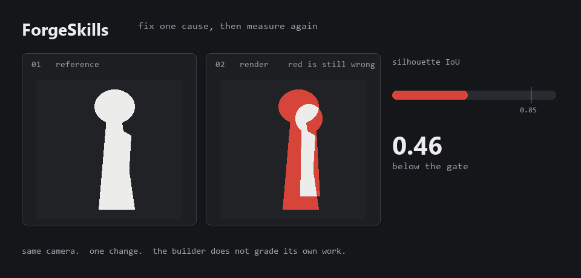
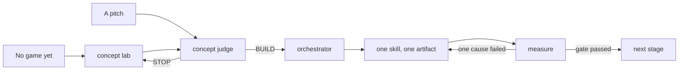

<p align="center">
  
</p>

# ForgeSkills

An agent will say the scene looks good. ForgeSkills makes it show the picture and the number.

28 skills for agents that write code, drive Blender, and ship game assets. Each one is a procedure with a gate: what to do, in what order, what to measure, and what counts as done. The opening score in the loop above, **0.46**, is a real result from this repo. The climb is the loop the skills run. The character those tools were aimed at never reached the 0.85 gate, and that failure is kept on purpose. See [`docs/TEST_RESULTS.md`](docs/TEST_RESULTS.md).

```
measure → build → render → compare → fix one thing → repeat
```

---

## Why use it

A model already knows a lot about games. What it does not do, unless you make it, is stop. It will build the whole game in one pass, call a saved file a success, and agree that the pitch is strong.

ForgeSkills is the stop.

- **A stage is an artifact.** A greybox, a render, a log, a competitor row with a date. A step with nothing you can open is not a step.
- **One change, then measure.** Two fixes in one pass teach nothing, because you cannot tell which one moved the number.
- **The builder does not grade itself.** A second check looks at the picture, the mesh, or the log. "Script exited 0" is not that check.
- **A new game is a market question first.** If you do not have a game yet, the agent asks what you can finish, opens store pages, and recommends one idea. It does not invent twenty themes.
- **Context stays small.** Descriptions are routing text, about 1,714 tokens for all 28, loaded so the agent can pick. The procedure loads only when that skill is chosen. Long tables stay in `references/` until a step asks for them. See [`docs/TOKEN_EFFICIENCY.md`](docs/TOKEN_EFFICIENCY.md).

---

## How it compares

This is a comparison of behaviour, not a claim about revenue or a benchmark win.

| | A longer prompt | One giant instructions file | ForgeSkills |
|---|---|---|---|
| How it starts | Writes the game | Reads everything, then writes the game | Refuses until the brief has a gate, or the pitch has a verdict |
| "Looks good" | Accepted | Restated in adjectives | A measurement from the same camera: silhouette, palette, or a frame-time |
| "It worked" | The script exited 0 | A checklist nobody ran | The artifact, opened. Renders, bounds, a test that can fail |
| A new idea | A list of themes | Agreement with the pitch | Shipped games, dated prices, verbatim complaints, then one recommendation |
| When it is wrong | Another full rewrite | Another full rewrite | One cause, then the same measurement again |
| What the chat carries | Every retry | The whole file, every time | A short description until the skill is actually needed |

What you give up: speed on the first attempt. A gated pass is slower than a single prompt. It is faster than the third rewrite of a scene nobody measured.

### One A/B, run on purpose

Same model, same brief, one variable: whether the agent read `gamedev-art-direction` and `gamedev-lighting` first.

<p align="center">
  
</p>

| | No skills | With skills |
|---|---|---|
| Palette | Generic, hard horizon | One palette, fire is the only accent |
| Lighting | Ad hoc | Key / fill 4:1 / rim, matched fog |
| Weak spot | Flat colour choices | Lower contrast, washed-out tent, shadow patches |
| Cost | ~66k tokens, 45 s | ~80k tokens, 72 s (+20%) |

The skills changed the method more than the picture. One pass is not the loop this library is built on, so this is a small result, not proof. Details and sources: [`docs/AB_TEST.md`](docs/AB_TEST.md), [`examples/ab-campfire/`](examples/ab-campfire/).

---

## Where to enter



| You want | Run |
|---|---|
| Ideas, and you have not chosen a game | `gamedev-concept-lab` |
| A verdict before anyone models a tree | `gamedev-concept-judge` |
| A brief turned into stages | `gamedev-orchestrator` |
| An asset that matches a picture | `gamedev-reference-reconstruction` → `gamedev-visual-iteration` |
| A scene that looks flat in Godot | `gamedev-godot-visual-polish` |
| A boss that feels random | `gamedev-boss-encounter` |
| Proof, not a status line | `gamedev-verification` |
| A bug that must not return | `gamedev-debugging` → `gamedev-game-testing` |

You do not have to name them. "Rebuild this character sheet as a 3D model" matches `gamedev-reference-reconstruction` on its own.

---

## What's in here

| Group | Skills |
|---|---|
| **Direction** | `gamedev-concept-lab`, `gamedev-concept-judge` |
| **Workflow** | `gamedev-orchestrator`, `gamedev-verification`, `gamedev-visual-iteration`, `gamedev-debugging`, `gamedev-game-testing` |
| **Assets** | `gamedev-reference-reconstruction`, `gamedev-blender-headless`, `gamedev-procedural-modeling`, `gamedev-modular-kit`, `gamedev-texture-authoring` |
| **Motion and feel** | `gamedev-animation`, `gamedev-locomotion`, `gamedev-vfx-impact` |
| **World and presentation** | `gamedev-lighting`, `gamedev-camera`, `gamedev-world-from-data`, `gamedev-godot-visual-polish`, `gamedev-foliage`, `gamedev-visual-artifacts`, `gamedev-art-direction` |
| **Systems and shipping** | `gamedev-gameplay-systems`, `gamedev-boss-encounter`, `gamedev-audio-wire`, `gamedev-performance`, `gamedev-godot-pipeline`, `gamedev-unity-pipeline` |

Full index: [`docs/README.md`](docs/README.md).

<details>
<summary><b>Direction</b> — before a new game, not during a task</summary>

| Skill | Solves |
|---|---|
| `gamedev-concept-lab` | "What should I make?" Asks team, time, engine, and refusals, scans shipped games, then recommends one loop plus one twist. |
| `gamedev-concept-judge` | "Is this worth building?" Five dated competitors, scores tagged as fact or inference, then BUILD, NARROW, or STOP. |

</details>

<details>
<summary><b>Workflow</b> — once the game is chosen</summary>

| Skill | Solves |
|---|---|
| `gamedev-orchestrator` | A one-line brief that has to become a staged build. Six-line contract. Blank lines are not allowed. |
| `gamedev-verification` | "It said success" with no evidence. Artifact checks, smoke tests, and the ways AI game work fakes a pass. |
| `gamedev-visual-iteration` | Visual work that stalls. Render, compare, rank the gaps, fix one cause, render again. |
| `gamedev-debugging` | A failure with an unclear cause, or a fix that made it worse. Reproduce, isolate, bisect. |
| `gamedev-game-testing` | "It works" turned into a test: smoke runs, state machines, visual regression, a bot on the path you did not play. |

</details>

<details>
<summary><b>Assets</b></summary>

| Skill | Solves |
|---|---|
| `gamedev-reference-reconstruction` | A concept sheet that must become the asset, not something inspired by it. Measured acceptance, a discrepancy ledger. |
| `gamedev-blender-headless` | Scripted Blender. Headless for batches, MCP when you are watching one prop, not clicking the UI. |
| `gamedev-procedural-modeling` | Lofts, capsules, sweeps, scatters. And when not to go procedural. |
| `gamedev-modular-kit` | Villages and rooms from parts: grid, pivots, one atlas. |
| `gamedev-texture-authoring` | Roughness and normals from one albedo, tiling, texel density. |

</details>

<details>
<summary><b>Motion and feel</b></summary>

| Skill | Solves |
|---|---|
| `gamedev-animation` | Rigs and clips by script, retargets, poses before in-betweens. |
| `gamedev-locomotion` | Floaty, slippery, or late movement when the animation is already fine. |
| `gamedev-vfx-impact` | Hits with no weight. Hit-stop, shake, layered particles, fracture. |

</details>

<details>
<summary><b>World and presentation</b></summary>

| Skill | Solves |
|---|---|
| `gamedev-lighting` | A scene that is lit and still reads flat. Key, fill, rim, a shadow budget. |
| `gamedev-camera` | A view that fights the player. |
| `gamedev-world-from-data` | Terrain, roads, and rivers from elevation data. |
| `gamedev-godot-visual-polish` | A Godot scene that looks default. Settings in a fixed order, then the frame cost of each one. |
| `gamedev-foliage` | Paper trees, a frozen world, grass that costs too much. Two shaders ship with the skill. |
| `gamedev-visual-artifacts` | Shimmer, acne, leaks, ghosting, z-fighting, hitches. Found by isolation, not hidden with blur. |
| `gamedev-art-direction` | Mixed packs that do not read as one game. |

</details>

<details>
<summary><b>Systems and shipping</b></summary>

| Skill | Solves |
|---|---|
| `gamedev-gameplay-systems` | Enemies, combat, inventory, spawning. The spec before the code. |
| `gamedev-boss-encounter` | A boss as a timeline: telegraph, active hit, recovery, lock-on that can step back. |
| `gamedev-audio-wire` | Chosen sounds hooked to events that already exist, license written down. Not a composer's workflow. |
| `gamedev-performance` | Draw calls, LOD, occlusion, what is on screen. |
| `gamedev-godot-pipeline` | Godot 4 import, scenes, autoloads, headless checks. |
| `gamedev-unity-pipeline` | Unity 6 import, prefabs, URP/HDRP, build checks. |

</details>

---

## Install

A skill is a folder with a `SKILL.md`. Installation is a copy. No build, no package manager.

```bash
git clone https://github.com/sekaikx/ForgeSkills.git
cd ForgeSkills
```

### Claude Code

Personal, every project on the machine:

```bash
# macOS / Linux
mkdir -p ~/.claude/skills
cp -r skills/gamedev-* ~/.claude/skills/

# Windows (PowerShell)
New-Item -ItemType Directory -Force "$env:USERPROFILE\.claude\skills" | Out-Null
Copy-Item skills\gamedev-* -Destination "$env:USERPROFILE\.claude\skills" -Recurse
```

Project, committed with the repo:

```bash
mkdir -p .claude/skills
cp -r ../ForgeSkills/skills/gamedev-* .claude/skills/
```

Claude matches a request to a skill's `description`, or you call one with `/gamedev-orchestrator`. Restart the session if `~/.claude/skills` did not exist when it started.

### Cursor

Cursor reads `.agents/skills/`, `.cursor/skills/`, and `.claude/skills/`.

```bash
# project
mkdir -p .agents/skills
cp -r ../ForgeSkills/skills/gamedev-* .agents/skills/

# personal
mkdir -p ~/.cursor/skills
cp -r ../ForgeSkills/skills/gamedev-* ~/.cursor/skills/
```

Type `/` in Agent chat and pick a skill by name.

### Other agents

| Tool | Path |
|---|---|
| Codex | `.codex/skills/` or `~/.codex/skills/` |
| Windsurf, Cline, Roo | Point the skill directory at `skills/`, or copy the folders |
| Anything else | One folder per skill, `SKILL.md` inside, YAML frontmatter with `name` and `description` |

If your agent only supports one rules file, concatenate the skills you need. All 28 at once defeats the routing.

### Tooling path

Skill bodies call `tools/refmatch/...` and `tools/texture/...` from the repo root. If the skills live elsewhere, symlink `tools/` or keep a checkout beside the project.

```bash
ln -s ~/ForgeSkills/tools ./tools
```

```powershell
New-Item -ItemType Junction -Path .\tools -Target "$env:USERPROFILE\ForgeSkills\tools"
```

Skip this and the procedures still read. The measurement steps need the scripts.

---

## Requirements

```bash
pip install -r requirements.txt
```

| Component | Needs |
|---|---|
| The skills themselves | Nothing |
| `tools/refmatch/*`, `tools/texture/tex_to_maps.py`, `tile_seam_check.py` | Python 3.10+, Pillow, numpy |
| `tools/texture/uv_density.py`, `tools/validate_skills.py`, `tools/token_budget.py` | Python 3.10+ |
| `tools/blender/*` | Blender 4.2+ or 5.x |
| Godot and Unity skills | The engine, and only when you run them |

Regenerate the header loop with `python tools/readme_hero.py`.

---

## Tooling

Check scripts exit nonzero on a failed check. `token_budget.py` does so only with `--strict`.

| Script | What it measures |
|---|---|
| `tools/validate_skills.py` | Frontmatter, cross-references, tool paths, technique ids, token caps |
| `tools/token_budget.py` | Description cost, body cost, reference cost |
| `tools/godot/ablation_capture.gd` | Frame time of each graphics setting, with a paired baseline |
| `tools/godot/ablation_report.py` | Cost against visible change, net of noise |
| `tools/refmatch/compare.py` | Silhouette IoU, band profile, palette ΔE, aspect. SSIM is advisory |
| `tools/refmatch/overlay.py` | Reference, render, and the pixels that disagree |
| `tools/refmatch/measure_sheet.py` | A clean crop and a palette from a concept sheet |
| `tools/refmatch/palette_report.py` | Named colour roles, per-role ΔE |
| `tools/texture/tex_to_maps.py` | Roughness, normal, and cavity from one albedo |
| `tools/texture/tile_seam_check.py` | Whether a tile wraps |
| `tools/texture/uv_density.py` | Texel density per part |
| `tools/blender/character_blockout.py` | A blockout from measured fractions |
| `tools/blender/render_compare_views.py` | Turnaround renders, fixed camera, alpha |
| `tools/blender/validate_scene.py` | Stray geometry, scale, meshes under the floor |
| `tools/blender/explorer_build.py` | Worked example of a garment pass |

```
measure_sheet → character_blockout → validate_scene → render_compare_views
     → compare + overlay → fix one cause → repeat
```

```bash
python tools/validate_skills.py
```

```
SKILL LIBRARY VALIDATION — 28 skills, 81 techniques known
ERRORS 0   WARNINGS 0
```

The validator failed itself once, by reporting zero errors after finding zero skills. An empty scan is now a hard failure.

---

## Rules that hold in every skill

1. **Measure, don't eyeball.** A visual claim carries a number.
2. **One variable per iteration.** Change two things and you learn nothing.
3. **Evidence or silence.** A success line from the tool that built the thing is not evidence.

---

## Honest status

Read [`docs/LIMITATIONS.md`](docs/LIMITATIONS.md) before trusting this with a ship date.

- **Exercised:** the workflow, the Blender pitfalls, the comparison and texture tools. Bugs in those tools were found by running them.
- **Written, not executed here:** everything Godot and Unity, including the ablation capture and both foliage shaders. Treat them as a spec until you run them.
- **One A/B:** skills vs no skills on the same brief. Mixed result, written up in [`docs/AB_TEST.md`](docs/AB_TEST.md).
- **CI:** the validator and unit tests for the measurement tools run on every push.
- **Failed its own test:** silhouette IoU 0.46 against a required 0.85. Documented, not deleted.
- **Not in this library:** dialogue, multiplayer, save systems, store-page production, writing music. Sound *wiring* is in. Composition is not.

---

## Layout

```
ForgeSkills/
├── skills/                    28 skills, one folder each
│   └── gamedev-<name>/SKILL.md   (+ references/ and assets/, loaded on demand)
├── tools/                     measurement, Blender, Godot ablation, this README's loop
├── tests/                     unit tests for the measurement tools
├── examples/ab-campfire/      the A/B scenes above
└── docs/
    ├── README.md              index of all 28 skills
    ├── TOKEN_EFFICIENCY.md    what the skills cost in context, and what they save
    ├── USAGE.md               worked command lines
    ├── TEST_RESULTS.md        what was run, including what failed
    ├── AB_TEST.md             skills vs no skills, same brief
    ├── LIMITATIONS.md         blind spots and unverified claims
    ├── COVERAGE.md            skill × technique matrix
    ├── transcript-sources.md  technique → source
    └── knowledge-base/        T-01 … T-81
```

Techniques trace to 16 transcripts from one channel, or are marked `engineering` when this library added a number the videos never stated. Market judgments are engineering: the videos never decide whether a game should exist. The evidence rules are adapted from [marketingskills](https://github.com/coreyhaines31/marketingskills) by Corey Haines (MIT).

---

## Contributing

A skill earns its place by being specific enough to disagree with.

1. `name` equals the directory name.
2. `description` says when to use it. That is what the agent matches on. Keep it short. It is loaded in every chat.
3. Include `## When to use` and `## When not to use`.
4. Every step produces an artifact.
5. A checkbox must be runnable by someone else.
6. Cross-reference other skills in backticks so the validator can resolve them.

Then:

```bash
python tools/validate_skills.py
pytest -q
```

Zero errors and green tests, or it does not land.

---

## License

Apache-2.0. See [`LICENSE`](LICENSE).
