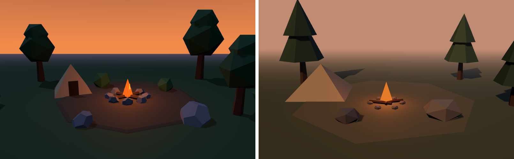

# A/B test: campfire scene, with and without skills

One run each, one pass each. This is an anecdote, not a benchmark.

## Setup

- Same model (a small, fast one) for both runs.
- Same brief: "low-poly campfire camp at dusk — ground, a tent, a campfire, 3 trees, 2 rocks".
  three.js, primitives only, fixed camera, 800x500.
- **A:** no skills.
- **B:** read `skills/gamedev-art-direction` and `skills/gamedev-lighting` first.
- Source: `examples/ab-campfire/A/index.html` and `examples/ab-campfire/B/index.html`.

## Result

Both rendered with no console errors.

| | A (no skills) | B (art direction + lighting) |
|---|---|---|
| Palette | Generic colours | One restrained palette; campfire is the only saturated accent |
| Horizon | Hard orange sky/ground line | Fog matched to background hides it |
| Lighting | Unplanned | Warm key ~34° off camera, cool fill at 1/4 key (4:1), cool rim |
| Contrast | Stronger | Lower overall; fire reads less as the focal point |
| Tent | Clear silhouette | Washed out and flat |
| Far ground | Clean | Dark shadow patches (likely a shadow-frustum artifact) |
| Tokens | ~66k | ~80k (about +20%) |
| Tool calls | 2 | 6 |
| Time | 45 s | 72 s |

## Verdict

The skills changed the method more than they produced a clearly better image in one pass. B
used named palette roles and a stated lighting ratio. A looked punchier and had a better tent.
B was not clearly better, and it cost about 20% more.

The repo's core claim is the measure-then-fix loop. This single pass did not run it, so the
test says little about that claim.

## Next test

Run `gamedev-visual-iteration` on B for three measured passes, then compare against A again.
